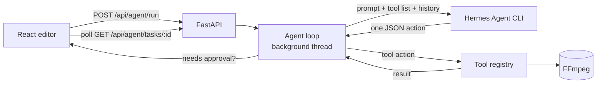

# AI Video Editor

**Edit videos by describing what you want.** Type *"clip from 1:00 to 3:00 in 9:16 and add subtitles"*, and an AI agent plans the steps, calls real FFmpeg tools one at a time, and returns the edited video.

Built with **FastAPI · React + TypeScript · FFmpeg · Hermes Agent (LLM)**.

<!-- Add a 30–60s demo GIF here: upload video → type a command → watch the agent's steps → download result -->

---

## What it does

- **Chat-driven editing.** Plain-English commands become a sequence of tool calls (trim, split, reframe, subtitle, clip, export).
- **Agent loop with a visible trace.** The agent first emits a plan, then one tool call per step. Every step (plan, tool call, result, error) shows up live in the UI so you can see exactly what it did.
- **Human-in-the-loop approval.** Risky tools (e.g. `run_shell`) pause the agent and wait for you to **Approve** or **Deny** in the UI. You can **Stop** any task mid-run.
- **Manual editor too.** Every tool is also available as a normal form in the UI (media, trim, split, aspect ratio, subtitles, export), backed by the same REST API.

### Video tools

| Tool | What it does |
|---|---|
| `trim_video` | Keep only `start_time` → `end_time` |
| `split_video` | Split into two clips at a timestamp |
| `change_aspect_ratio` | Reframe to `16:9`, `9:16`, `1:1` or `4:5` |
| `clip_video` | Trim + optional reframe in one step (e.g. YouTube Short) |
| `add_subtitles` | Write an SRT from `{start, end, text}` items and mux it in as a subtitle track |
| `get_video_info` / `upload_video` / `export_video` | Metadata, register a file, get the final file |

### General agent tools

| Tool | Approval |
|---|---|
| `list_files`, `read_file` (project exploration) | no |
| `browse_url` (title, headings, text preview of a page) | no |
| `run_shell` (command in the project directory) | **required** |

---

## How the agent works



The model has **no tools of its own**. Every reply must be exactly one JSON object:

```json
{"action": "plan",  "steps": ["clip 60s-180s", "reframe to 9:16", "add subtitles"]}
{"action": "tool",  "tool": "clip_video", "arguments": {"video_id": "…", "start_time": 60, "end_time": 180, "ratio": "9:16"}}
{"action": "final", "answer": "Done. Your 2-minute vertical clip is ready."}
```

The executor validates the tool name against the registry, runs it, appends the (truncated) result to the conversation, and asks for the next action.

**Reliability guards**

- Tool definitions are JSON-Schema typed and shared between the UI, the REST API and the agent prompt (`app/tools/registry.py`).
- Unknown tool names are rejected and fed back to the model as an error.
- Malformed replies are retried (up to 2 times) with the bad output quoted back.
- Hard limit of **8 steps** per task; conversation history is trimmed to stay within context.
- LLM calls retry with backoff on CLI failures or empty output.

---

## Tech stack

| Layer | Tech |
|---|---|
| Backend | Python, FastAPI, Pydantic v2, pydantic-settings |
| Media | FFmpeg / ffprobe via `subprocess` |
| AI | Hermes Agent CLI as the reasoning model; custom plan → tool → final loop |
| Frontend | React 18, TypeScript, Vite, Tailwind CSS, lucide-react |

---

## Project structure

```
ai-editor/
├── backend/
│   └── app/
│       ├── main.py              # FastAPI app, CORS, routers
│       ├── config.py            # settings (env-overridable)
│       ├── api/
│       │   ├── video.py         # REST endpoints for manual editing
│       │   └── agent.py         # run / poll / stop / approve agent tasks
│       ├── services/
│       │   ├── agent_loop.py    # plan → tool → final loop, approvals, task manager
│       │   ├── hermes.py        # Hermes CLI gateway (retries, JSON parsing)
│       │   └── store.py         # in-memory video store
│       ├── tools/
│       │   ├── registry.py      # tool schemas + dispatch table
│       │   ├── video_editor.py  # FFmpeg-backed video tools
│       │   └── general.py       # list_files, read_file, browse_url, run_shell
│       └── utils/ffmpeg.py      # run_ffmpeg, probe_duration, validation
└── frontend/
    └── src/
        ├── pages/Editor.tsx     # editor UI, AI panel, step trace, approvals
        └── services/api.ts      # typed API client
```

---

## Run it locally

**Prerequisites:** Python 3.10+, Node 18+, [FFmpeg](https://ffmpeg.org/download.html) on your `PATH`, and the [Hermes Agent](https://github.com/NousResearch/hermes-agent) CLI installed.

**Backend**

```bash
cd ai-editor/backend
python -m venv .venv
.venv\Scripts\activate          # macOS/Linux: source .venv/bin/activate
pip install -r requirements.txt
set HERMES_CLI=C:\path\to\hermes.exe   # macOS/Linux: export HERMES_CLI=/path/to/hermes
uvicorn app.main:app --reload --port 8000
```

**Frontend**

```bash
cd ai-editor/frontend
npm install
npm run dev                      # http://localhost:5173
```

Set `HERMES_CLI` to your Hermes binary and, if FFmpeg isn't on your `PATH`, `FFMPEG_BIN` to its location. Uploads and outputs are written to `ai-editor/backend/media/`.

---

## API

| Method | Endpoint | Purpose |
|---|---|---|
| `POST` | `/api/videos/upload` | Upload a video |
| `GET` | `/api/videos/{id}` | Video metadata |
| `GET` | `/api/videos/{id}/download` | Download a video |
| `POST` | `/api/videos/{id}/trim` · `/split` · `/aspect-ratio` · `/subtitles` · `/clip` · `/export` | Manual edits |
| `GET` | `/api/agent/tools` | List tool schemas |
| `POST` | `/api/agent/run` | Start an agent task `{command, video_id}` |
| `GET` | `/api/agent/tasks/{task_id}` | Poll status, plan, steps, final answer |
| `POST` | `/api/agent/tasks/{task_id}/approval` | Approve / deny a pending tool `{approved}` |
| `POST` | `/api/agent/tasks/{task_id}/stop` | Stop a running task |
| `POST` | `/api/agent/call` | Call one tool directly `{tool, arguments}` |

---

## Limitations & next steps

- Built for **local use**: `run_shell` executes commands on the host (approval-gated), and CORS is open. Don't expose it to the internet as-is.
- Tasks and videos live in memory, so they reset when the server restarts.
- Subtitles are added as a soft track; next: burn-in captions and auto-generated captions from speech-to-text.
- Next: server-sent events instead of polling, timeline preview of each step, and pluggable LLM backends (OpenAI-compatible APIs).

---

**Author:** Sakshi Gaikwad · [sakshii.tech](https://sakshii.tech/) · [GitHub](https://github.com/SakshiGaikwad05)
